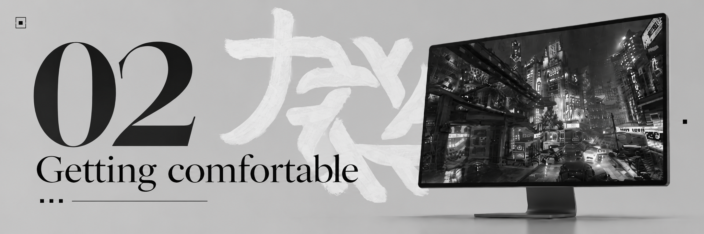
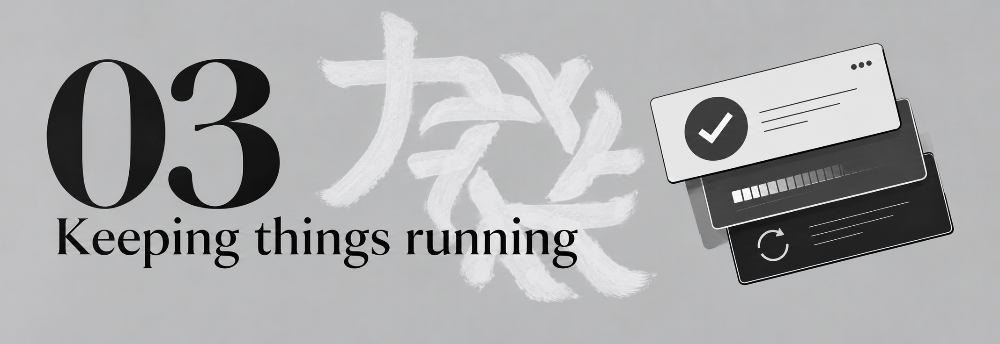
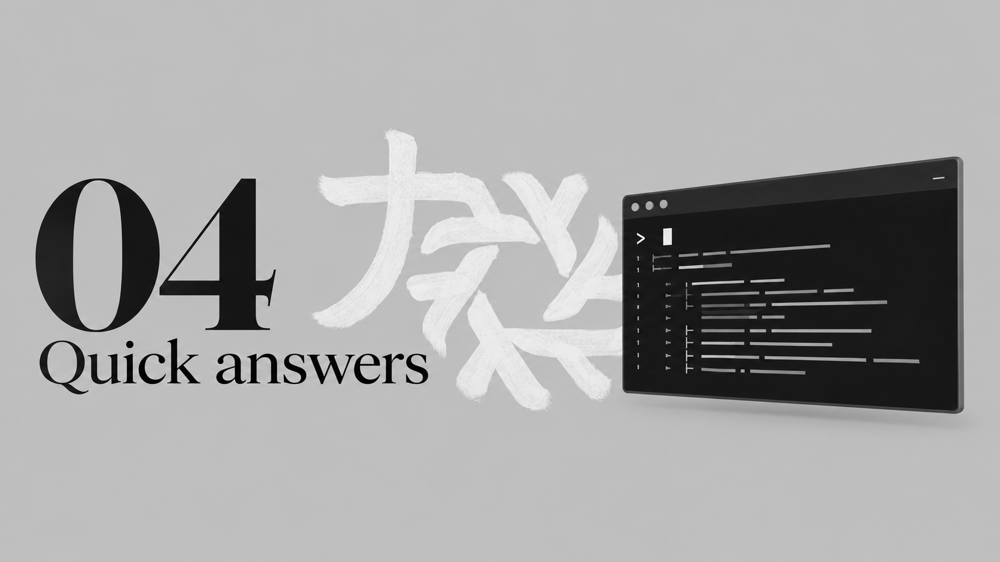

 

**力と美のために**  ·  For the sake of power and beauty

### The Ryoku on NixOS Documentation

[**Get started →**](guides/start-here.md) &nbsp; · &nbsp; [**Install Ryoku →**](guides/install-on-nixos.md) &nbsp; · &nbsp; [**Fix a problem →**](guides/troubleshooting.md)

---

## Where should I start?

You don't need to read everything, just the sections that apply to you :).

<table>
  <tr>
    <td width="33%" valign="top">
      
      
<a href="guides/start-here.md"><strong>Im new to Linux →</strong></a>

    </td>
    <td width="33%" valign="top">
      
      
<a href="guides/script-installer.md"><strong>I already use NixOS →</strong></a>

    </td>
    <td width="33%" valign="top">
      
      
<a href="guides/troubleshooting.md"><strong>I need help →</strong></a>

    </td>
  </tr>
</table>

## Explore the guides

<table>
  <tr>
    <td width="50%" valign="top">
      
      <h3>01 &nbsp; Getting started</h3>
      
<a href="guides/start-here.md"><strong>Start here ↗</strong></a> What NixOS and Ryoku are.

      
<a href="guides/before-you-install.md"><strong>Before you install ↗</strong></a> Backups, hardware, and choosing a route.

      
<a href="guides/script-installer.md"><strong>Install Ryoku on NixOS ↗</strong></a> Guided installation, explained step by step.

      
<a href="guides/install-from-iso.md"><strong>Installer USB and ISO ↗</strong></a> What to know before a fresh install.

    </td>
    <td width="50%" valign="top">
      
      <h3>02 &nbsp; Getting Comfortable</h3>
      
<a href="guides/first-boot.md"><strong>Your first 10 minutes ↗</strong></a> Find apps, settings and the essentials.

      
<a href="guides/personalise.md"><strong>Make Ryoku Customisable ↗</strong></a> Wallpapers, colours, bars and launchers.

      
<a href="guides/applications.md"><strong>Packages and Software ↗</strong></a> How installing apps differs from Windows and other distros.

      
<a href="guides/glossary.md"><strong>NixOS explained simply ↗</strong></a> Flakes, rebuilds, generations, and other new terms.

    </td>
  </tr>
  <tr>
    <td width="50%" valign="top">
      
      <h3>03 &nbsp; Keeping things running</h3>
      
<a href="guides/updates.md"><strong>Updates and rebuilds ↗</strong></a> What an update changes and how to apply one.

      
<a href="guides/recovery.md"><strong>Return to a working system ↗</strong></a> Understanding previous NixOS generations.

      
<a href="guides/troubleshooting.md"><strong>Fix common problems ↗</strong></a> Useful checks and what to share when asking for help.

    </td>
    <td width="50%" valign="top">
      
      <h3>04 &nbsp; Quick answers</h3>
      
<a href="guides/commands.md"><strong>Commands that matter ↗</strong></a> A few commands you'll actually use, with explanations.

      
<a href="guides/faq.md"><strong>Frequently asked questions ↗</strong></a> Straight answers about Windows, graphics, updates, and more.

      
<a href="CONTRIBUTING.md"><strong>Help improve these docs ↗</strong></a> How to make a guide clearer or report an outdated step.

    </td>
  </tr>
</table>

## Your first journey

**Coming from Windows?** Here's a simple order to follow. Click one step at a time.

**[1. Understand the basics](guides/start-here.md)** → **[2. Prepare safely](guides/before-you-install.md)** → **[3. Install](guides/install-on-nixos.md)** → **[4. Explore your desktop](guides/first-boot.md)**

> [!IMPORTANT]
> **Installing Ryoku on an existing NixOS system is not the same as installing NixOS from a USB drive.** The guided Ryoku installer does not partition your disks. The .iso **erases the disk you select** and does not support manual partitioning. If you're using Windows, read [Before you install](guides/before-you-install.md) before touching a drive.

## What makes NixOS different?

| Windows | Ryoku on NixOS |
| :--- | :--- |
| The Start menu opens your apps | The Ryoku app launcher opens your apps |
| Settings controls your system | Ryoku Hub controls much of your desktop, while NixOS manages system configuration |
| Many programs use `.exe` installers | Apps can be included in your NixOS configuration or installed through supported package systems |
| Windows updates change the installed system | NixOS builds new **generations**, making many system changes easier to reverse |

New terms? [The glossary explains them without assuming you're an experienced user.](guides/glossary.md)

## Project and support

[**Ryoku on NixOS**](https://github.com/Ryoku-dev/Ryoku-on-NixOS) · [**Upstream**](https://github.com/Ryoku-dev/ryoku) · [**Report a bug**](https://github.com/Ryoku-dev/Ryoku-on-NixOS/issues) · [**Community Discord**](https://discord.gg/xvr69NRsmt)

This handbook explains the beginner experience. For detailed technical behaviour, the [maintained NixOS port guide](https://github.com/Ryoku-dev/Ryoku-on-NixOS/blob/main/docs/nixos.md) is the reference.

---

FOR THE SAKE OF POWER AND BEAUTY.

