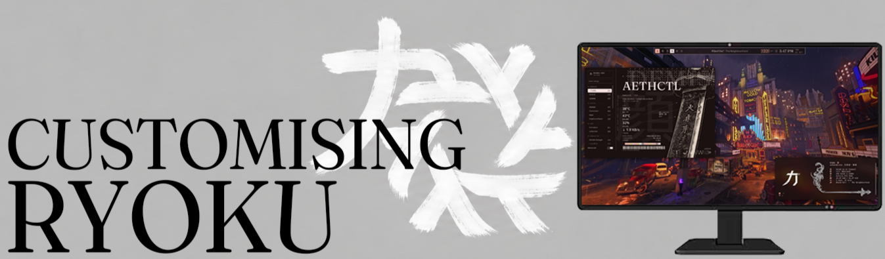
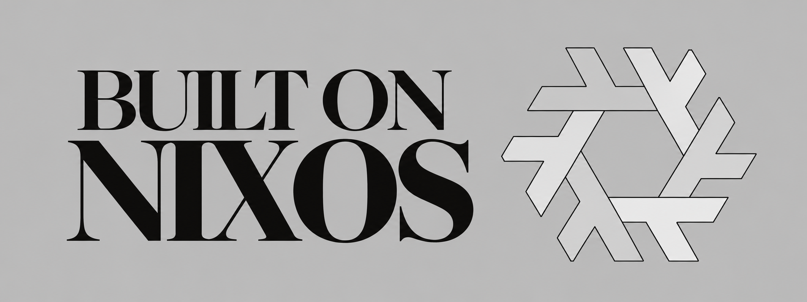
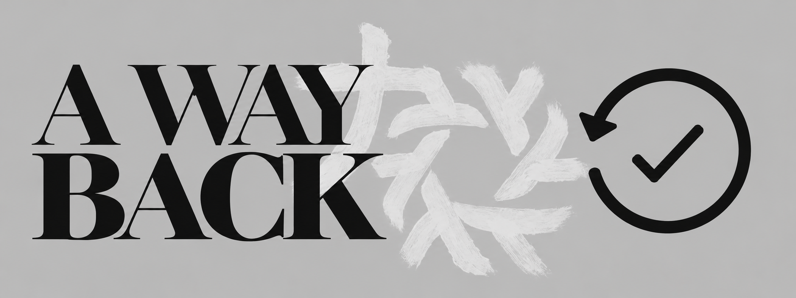

 

**力と美のために**  ·  For the sake of power and beauty

### The Ryoku on NixOS Documentation

[**Get started →**](guides/start-here.md) &nbsp; · &nbsp; [**Install Ryoku →**](guides/install-on-nixos.md) &nbsp; · &nbsp; [**Fix a problem →**](guides/troubleshooting.md)

---

## Explore the guides (All images are hyperlinks to the relevant page)

<table>
  <tr>
    <td width="50%" valign="top">
      </a>
         
         
         
    </td>
    <td width="50%" valign="top">
      </a>
         
         <a href="guides/personalise.md"></a
         <a href="guides/applications.md"></a
         <a href="guides/glossary.md"></a
    </td>
  </tr>
  <tr>
    <td width="50%" valign="top">
      </a>
         <a href="guides/updates.md"></a
         <a href="guides/recovery.md"></a
         <a href="guides/troubleshooting.md"></a
    </td>
    <td width="50%" valign="top">
      
      <h3>04 &nbsp; Quick answers</h3>
      
<a href="guides/commands.md"><strong>Commands that matter ↗</strong></a> A few commands you'll actually use, with explanations.

      
<a href="guides/faq.md"><strong>Frequently asked questions ↗</strong></a> Straight answers about Windows, graphics, updates, and more.

      
<a href="CONTRIBUTING.md"><strong>Help improve these docs ↗</strong></a> How to make a guide clearer or report an outdated step.

    </td>
  </tr>
</table>

## Where should I start?

You don't need to read everything, just the sections that apply to you :).
(Images are hyperlinks to the specific page)

<table>
  <tr>
    <td width="33%" valign="top">
      
    </td>
    <td width="33%" valign="top">
      
    </td>
    <td width="33%" valign="top">
      
    </td>
  </tr>
</table>

## What makes Ryoku on NixOS different to floating window Desktop Environments?

| Others | Ryoku on NixOS |
| :--- | :--- |
| The Start menu opens your apps | The Ryoku app launcher opens your apps |
| Settings controls your system | Ryoku Hub controls much of your desktop, while NixOS manages system configuration |
| Many programs use `.exe` installers | Apps can be included in your NixOS configuration or installed through supported package systems |
| Windows updates change the installed system | NixOS builds new **generations**, making many system changes easier to reverse |

Dont know what a word means? [The glossary explains them without assuming you're an experienced user.](guides/glossary.md)

## Project and support

[**Ryoku on NixOS**](https://github.com/Ryoku-dev/Ryoku-on-NixOS) · [**Report a bug**](https://github.com/Ryoku-dev/Ryoku-on-NixOS/issues) · [**Community Discord**](https://discord.gg/xvr69NRsmt)

This handbook explains the beginner experience. For detailed technical behaviour, the [maintained NixOS port guide](https://github.com/Ryoku-dev/Ryoku-on-NixOS/blob/main/docs/nixos.md) is the reference.

---

FOR THE SAKE OF POWER AND BEAUTY.

